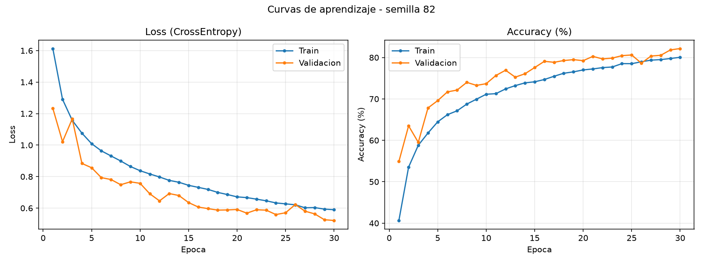
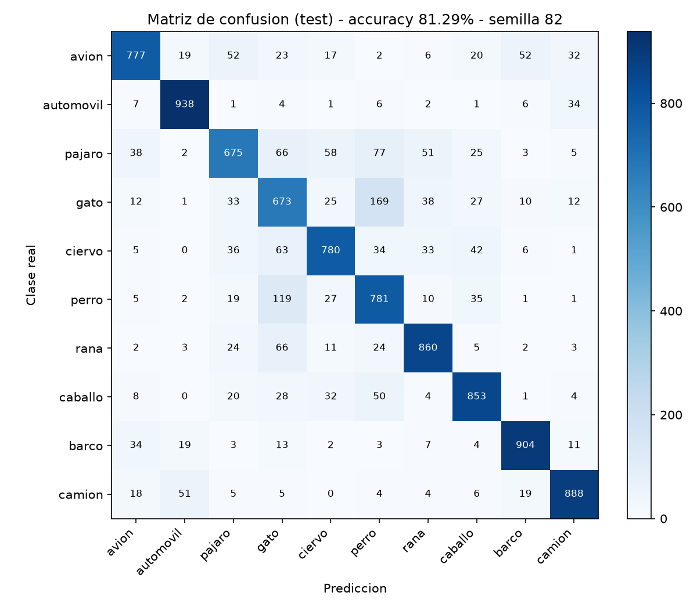

# Clasificación de imágenes CIFAR-10 con una CNN en PyTorch

**Universidad Andina del Cusco – Ingeniería de Sistemas**
**Evaluación de la Segunda Unidad – Inteligencia Artificial**

| | |
|---|---|
| **Estudiante** | Gonzalo Fredy Puelles Zapata |
| **Código de matrícula** | 022101082H |
| **Semilla individual** | **82** (`torch.manual_seed(82)` y `np.random.seed(82)`) |
| **Dataset** | CIFAR-10 (60 000 imágenes RGB de 32×32, 10 clases) vía `torchvision.datasets` |

---

## 1. Estructura del repositorio

```
cnn-cifar10-seed82/
├── src/
│   ├── dataset.py          # Pregunta 1: carga, semilla, transforms, partición, visualización
│   ├── model.py            # Pregunta 3: CNN + validación de shapes 4D
│   └── train.py            # Pregunta 4: entrenamiento, métricas, gráficas
├── notebooks/
│   └── experiment.ipynb    # EDA, pruebas y visualización de muestras
├── outputs/
│   ├── loss_accuracy.png   # curvas de aprendizaje
│   └── confusion_matrix.png
├── requirements.txt
└── README.md
```

## 2. Cómo ejecutar

```bash
pip install -r requirements.txt
python src/dataset.py     # descarga CIFAR-10, imprime particiones, guarda grilla de muestras
python src/model.py       # valida los shapes 4D con un batch simulado
python src/train.py       # entrena, guarda gráficas y actualiza este README
```

La semilla **82** se aplica en `src/dataset.py` (constante `SEED`, función `set_seed`) y gobierna: la mezcla de los datos, la partición estratificada, el orden de los batches, la inicialización de pesos de la red y la aleatoriedad del Data Augmentation.

---

## 3. Pregunta 1 – Datos, transformaciones y partición

- **Carga:** `datasets.CIFAR10(..., download=True)`; 50 000 imágenes de entrenamiento y 10 000 de prueba.
- **Visualización:** `show_samples(16)` grafica una cuadrícula de 16 imágenes con su clase real (ver `outputs/sample_grid.png`).
- **Pipeline de transformaciones (entrenamiento):** `RandomCrop(32, padding=4)` → `RandomHorizontalFlip(0.5)` → `ToTensor()` → `Normalize(mean, std)` por canal RGB.
- **Validación y prueba:** solo `ToTensor()` + `Normalize()` (sin aumento de datos, para medir el rendimiento real).
- **Partición estratificada:** 80 % entrenamiento (40 000) / 20 % validación (10 000), conservando 4 000 / 1 000 imágenes por clase respectivamente, con la semilla 82.

---

## 4. Pregunta 2 – Diseño arquitectónico: CNN frente a MLP

### 4.1 Justificación teórica

Una imagen de CIFAR-10 es un tensor de 3×32×32 = **3 072 valores**. Un Perceptrón Multicapa (MLP) exige aplanar la imagen en un vector, lo que genera tres problemas:

1. **Explosión de parámetros.** Una sola capa oculta de 1 024 neuronas ya requiere 3 072 × 1 024 ≈ **3,1 millones de pesos**. Con imágenes reales de 224×224×3 (150 528 entradas) la misma capa tendría ≈ **154 millones** de pesos. Esto es costoso en memoria y cómputo, y favorece el sobreajuste con solo 50 000 imágenes.
2. **Pérdida de la estructura espacial.** Al aplanar, píxeles vecinos y píxeles lejanos se tratan igual: el MLP no sabe que existe una vecindad 2D, por lo que debe aprender esa relación desde cero.
3. **Sin invariancia a la traslación.** Si un objeto se desplaza unos píxeles, el vector de entrada cambia por completo y el MLP debe aprender el mismo patrón por separado para cada posición.

Las CNN resuelven estas limitaciones con tres propiedades:

- **Conexiones locales (campo receptivo):** cada neurona solo observa una ventana pequeña (3×3), capturando bordes y texturas locales, y las capas más profundas combinan ese contexto en formas y objetos.
- **Weight Sharing (pesos compartidos):** el mismo filtro se desliza por toda la imagen. La primera capa convolucional usa solo 3 × 32 × 3 × 3 + 32 = **896 parámetros**, frente a millones en una capa densa.
- **Invariancia (equivarianza) espacial:** como el mismo filtro se aplica en todas las posiciones, un patrón se detecta sin importar dónde aparezca; el `MaxPool2d` añade además tolerancia a pequeños desplazamientos y reduce la resolución espacial.

### 4.2 Especificación de la arquitectura

| # | Capa | Configuración | Shape de salida (B = batch) |
|---|---|---|---|
| – | Entrada | imagen RGB normalizada | (B, 3, 32, 32) |
| 1 | Conv2d | 3 → 32, kernel 3×3, padding 1 | (B, 32, 32, 32) |
| 2 | BatchNorm2d + ReLU | 32 canales | (B, 32, 32, 32) |
| 3 | MaxPool2d | 2×2 | (B, 32, 16, 16) |
| 4 | Conv2d | 32 → 64, kernel 3×3, padding 1 | (B, 64, 16, 16) |
| 5 | BatchNorm2d + ReLU | 64 canales | (B, 64, 16, 16) |
| 6 | MaxPool2d | 2×2 | (B, 64, 8, 8) |
| 7 | Conv2d | 64 → 128, kernel 3×3, padding 1 | (B, 128, 8, 8) |
| 8 | BatchNorm2d + ReLU | 128 canales | (B, 128, 8, 8) |
| 9 | MaxPool2d | 2×2 | (B, 128, 4, 4) |
| 10 | Flatten | 128 × 4 × 4 | (B, 2048) |
| 11 | Linear + ReLU + Dropout(0.5) | 2048 → 256 | (B, 256) |
| 12 | Linear | 256 → 10 (clases) | (B, 10) |

Son **3 bloques convolucionales** (cada uno con Conv2d, ReLU y MaxPool2d; se añade BatchNorm2d para estabilizar el entrenamiento) y **2 capas densas** (`Linear`) hacia las 10 clases. Total: **620 810 parámetros entrenables**.

---

## 5. Pregunta 3 – Tensores 4D y validación del forward pass

El formato de entrada es `(Batch_Size, Channels, Height, Width)`. En `src/model.py`:

- `forward()` verifica con `assert` que el tensor sea 4D.
- Se usa `nn.Flatten()` entre el último bloque convolucional `(B,128,4,4)` y la primera capa densa `Linear(2048, 256)`: 32 → 16 → 8 → 4 por los tres `MaxPool2d`, y 128 × 4 × 4 = 2048.
- El bloque `if __name__ == "__main__"` pasa un batch simulado `torch.randn(8, 3, 32, 32)` por `trace_shapes()` e imprime los shapes intermedios, validando con `assert` que la salida sea `(8, 10)`.

Salida esperada de `python src/model.py`:

```
Entrada                     (8, 3, 32, 32)
Bloque 1 (Conv-BN-ReLU-Pool)(8, 32, 16, 16)
Bloque 2 (Conv-BN-ReLU-Pool)(8, 64, 8, 8)
Bloque 3 (Conv-BN-ReLU-Pool)(8, 128, 4, 4)
Flatten                     (8, 2048)
Clasificador (Linear)       (8, 10)
```

---

## 6. Pregunta 4 – Entrenamiento y análisis

**Configuración:** `CrossEntropyLoss`, optimizador `Adam` (lr = 1e-3, weight decay = 1e-4), batch de 128 y 30 épocas. Se guardan los pesos de la época con mayor accuracy de validación y se evalúa una sola vez sobre el conjunto de prueba.

<!-- RESULTADOS_START -->
### Resultados obtenidos (semilla 82)

| Metrica | Entrenamiento | Validacion | Prueba (test) |
|---|---|---|---|
| Accuracy final (epoca 30) | 80.06% | 82.17% | 81.29% |
| Loss final | 0.5901 | 0.5216 | 0.5421 |

- Parametros entrenables: **620,810**
- Mejor epoca (mayor accuracy de validacion): **30** (82.17%)
- Epoca con menor loss de validacion: **30** (0.5216)
- Brecha de accuracy train - val: **-2.11 puntos porcentuales**
- Brecha de loss val - train: **-0.0685**





### Analisis critico

**Diagnostico:** **Ajuste adecuado (sin overfitting ni underfitting significativos)**: train y validacion evolucionan juntas y con brecha pequena.

- El modelo alcanza **81.29%** de accuracy en el conjunto de prueba independiente, frente a 80.06% en entrenamiento y 82.17% en validacion. La diferencia entre validacion y prueba es de 0.88 puntos, lo que indica que la validacion fue una estimacion fiable de la generalizacion.
- La brecha train-validacion de -2.11 p.p. (y -0.0685 en loss) es el indicador cuantitativo principal de overfitting. El loss de validacion alcanzo su minimo en la epoca 30 y al final esta 0.0000 por encima de ese minimo.
- Las tecnicas de regularizacion usadas (Data Augmentation con RandomCrop + RandomHorizontalFlip, Dropout 0.5, BatchNorm y weight decay) reducen la memorizacion. Por ello el accuracy de entrenamiento (medido con augmentation activa) puede ser incluso menor o similar al de validacion en las primeras epocas.
- Clases mejor clasificadas: automovil (93.8%), barco (90.4%), camion (88.8%). Clases mas dificiles: gato (67.3%), pajaro (67.5%), avion (77.7%).
- Confusion mas frecuente: **gato predicho como perro** (169 imagenes), esperable por similitud visual entre ambas clases a 32x32 pixeles.

<!-- RESULTADOS_END -->
